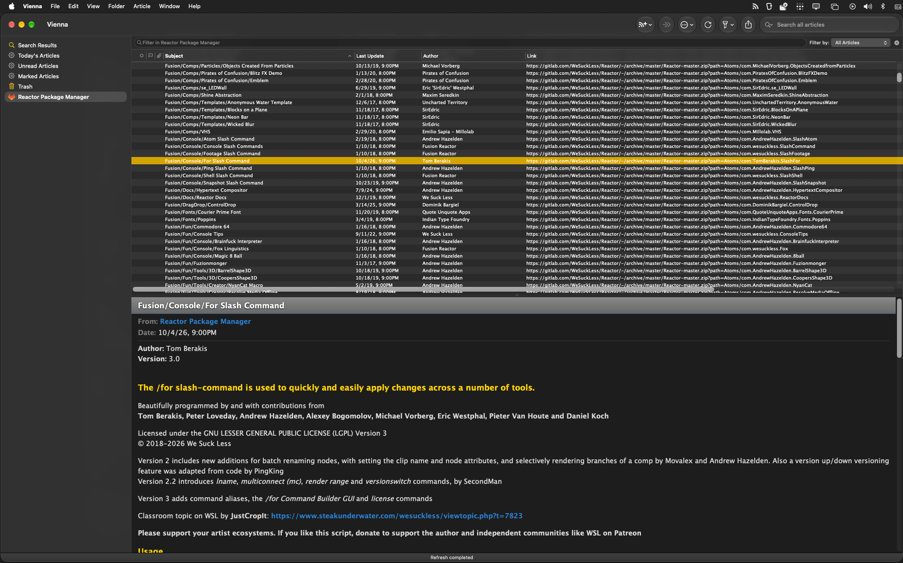
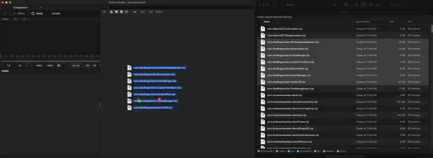
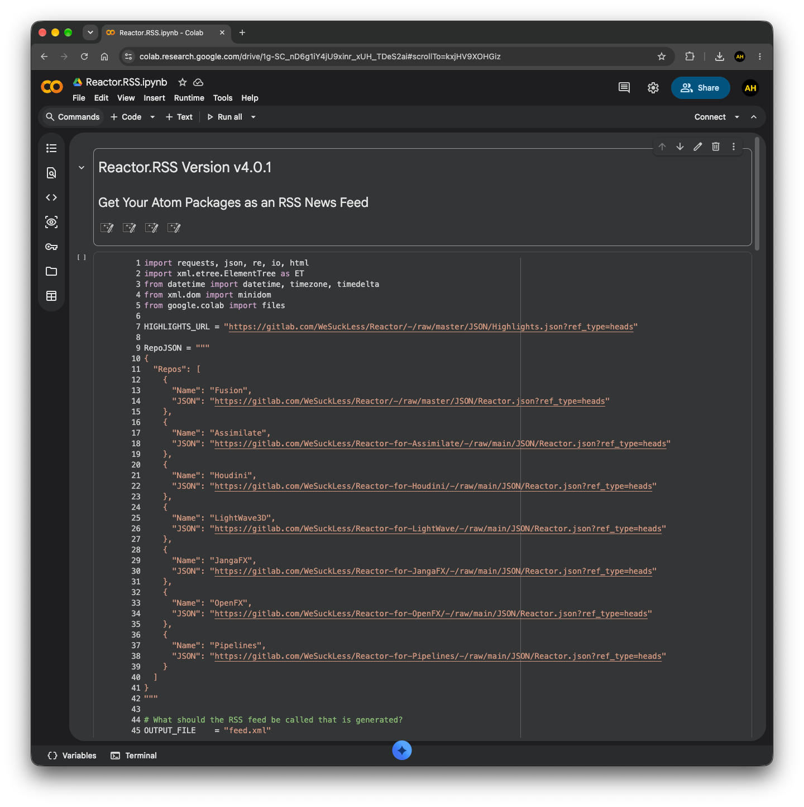

# Reactor.RSS
## A RSS newsfeed of the latest Reactor Package Manager atoms

Developed By: Andrew Hazelden  
Last Updated: 2026-10-27  

## Overview

Reactor.RSS was developed as a backup "life-raft" 🛟 option to help smooth over the ocasional rough patches when "[Reactor Classic](https://gitlab.com/WeSuckLess/Reactor)" or "[Reactor Standalone](https://github.com/Kartaverse/Reactor-Standalone)" have technical issues running on a computer.

An [RSS newsfeed](https://en.wikipedia.org/wiki/RSS) is an old-school way to explore news that is published online. This allows you to subscribe to news and information updates on topics you care to know more about. This approach works equally well on desktops, laptops, tablets, phones, and web browsers. The specification for [RSS can be read here](https://www.rssboard.org/rss-specification).

When you access Reactor via an RSS newsfeed in your favorite news reader app, you get access to the full Reactor atom library of content. Each Reactor atom package, and the sidebar "highlight" news item, is listed as  new story entries that are syndicated using the XML based RSS newsfeed protocol.

An interesting trick is that you can use the Reactor RSS newsfeed approach on your iPadOS device to install Reactor hosted macros, effects templates, and DCTL LUTs for use with Resolve Studio for iPad. This is something new as far as capabilities go. 

RSS Newsfeed URL:
- [https://gitlab.com/WeSuckLess/Reactor/-/raw/master/RSS/feed.xml?ref_type=heads](https://gitlab.com/WeSuckLess/Reactor/-/raw/master/RSS/feed.xml?ref_type=heads)

## RSS Readers

Local RSS Reader for macOS:
- [Vienna RSS](https://www.vienna-rss.com/)



## Atomz Package Downloading

When you double-click on a news story entry in the Reactor.RSS newsfeed, you are provided with a zipped atom package download that is generated automatically by the Reactor GitLab Repository. This allows you to collect together any atom packaged item you want without needing to have Reactor Standalone or Reactor Classic operational on the host system.

After you download the atom package from ReactorRSS, the Reactor "Atomz Expand" toolset helps you perform a desktop folder based "drag and drop" install of your Reactor zipped atom packages. Here is a link to the [Steakunderwater forum topic that has more information about the Atomz Expand script](https://www.steakunderwater.com/wesuckless/viewtopic.php?t=6115).

Atomz Expand makes for a relatively quick and low friction way to install a lot of locally stored .zip based atoms, and have them added in only a few quick moments. This task runs directly inside the Resolve and Fusion based Console window. The results of the installation process are shown as text output in the Console window.



Atomz are drag, drop, installed. It's just that easy. :)

## Modifying your RSS Newsfeed

The ReactorRS newsfeed "feed.xml" document is generated using an open-source Google Collab "Jupyter Notebook" file. If you wish, you can prune the Rector RSS newsfeed down to the exact atom packaged topics you care about or use this data for other purposes.



### Feed Details

Google Colab Notebook:

- [Reactor_RSS.ipynb](https://colab.research.google.com/drive/1g-SC_nD6g1iY4jU9xinr_xUH_TDeS2ai)

At the top of the Collab Notebook is where each of the Reactor repository JSON sources are defined:

```Python
RepoJSON = """
{
  "Repos": [
    {
      "Name": "Fusion",
      "JSON": "https://gitlab.com/WeSuckLess/Reactor/-/raw/master/JSON/Reactor.json?ref_type=heads"
    },
    {
      "Name": "Assimilate",
      "JSON": "https://gitlab.com/WeSuckLess/Reactor-for-Assimilate/-/raw/main/JSON/Reactor.json?ref_type=heads"
    },
    {
      "Name": "Houdini",
      "JSON": "https://gitlab.com/WeSuckLess/Reactor-for-Houdini/-/raw/main/JSON/Reactor.json?ref_type=heads"
    },
    {
      "Name": "LightWave3D",
      "JSON": "https://gitlab.com/WeSuckLess/Reactor-for-LightWave/-/raw/main/JSON/Reactor.json?ref_type=heads"
    },
    {
      "Name": "JangaFX",
      "JSON": "https://gitlab.com/WeSuckLess/Reactor-for-JangaFX/-/raw/main/JSON/Reactor.json?ref_type=heads"
    },
    {
      "Name": "OpenFX",
      "JSON": "https://gitlab.com/WeSuckLess/Reactor-for-OpenFX/-/raw/main/JSON/Reactor.json?ref_type=heads"
    },
    {
      "Name": "Pipelines",
      "JSON": "https://gitlab.com/WeSuckLess/Reactor-for-Pipelines/-/raw/main/JSON/Reactor.json?ref_type=heads"
    }
  ]
}
"""
```

